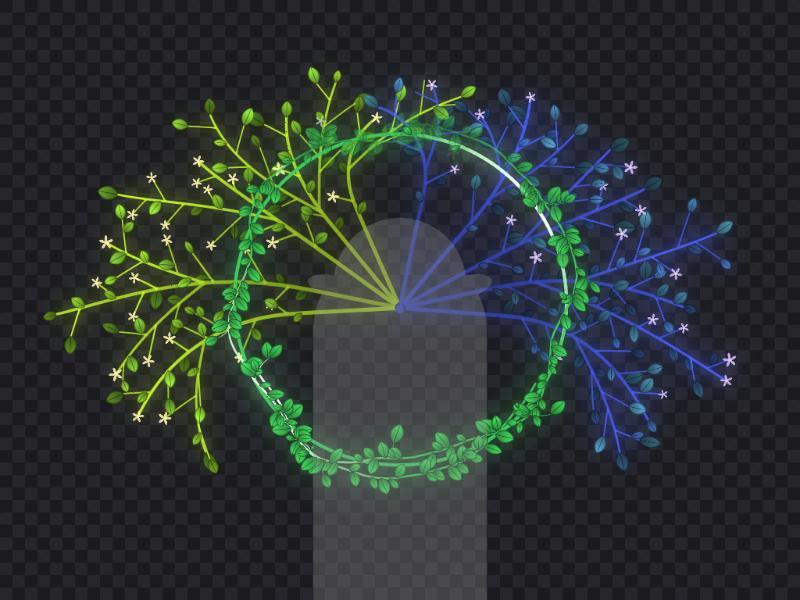
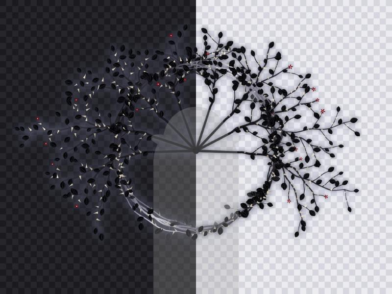
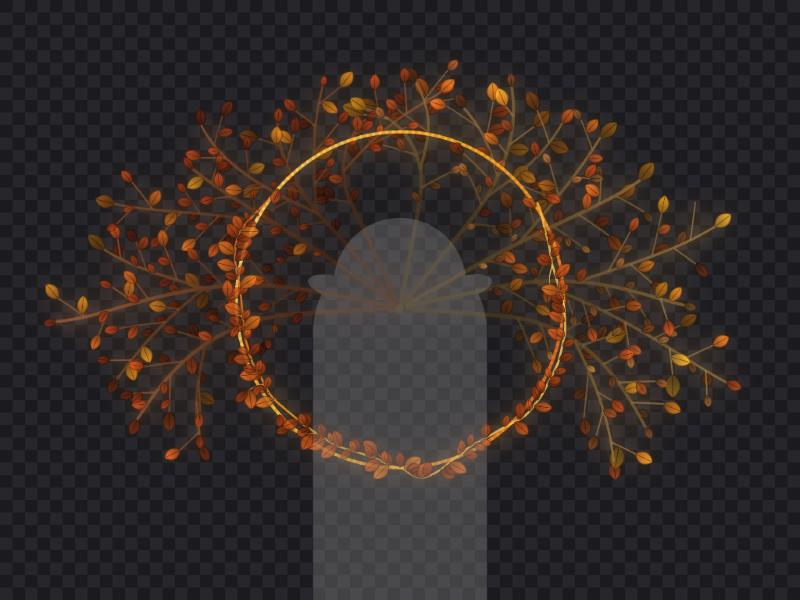
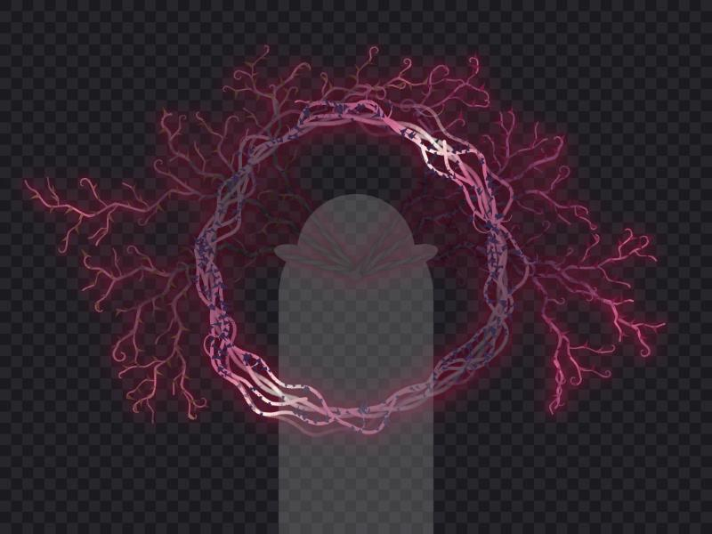

# Sprout Visualizer

An audio-reactive stage overlay for VTubers who sing and record themselves live. A glowing halo
grows behind your avatar while you sing, and every take you record is planted as its own tree.
The trees grow with each phrase, rest in pauses and wither away after a long silence. They sway
with your loudness, shiver with your vibrato and bloom on long held notes.



| Black briar (half dark, half light background) | Autumn | Dark & twisted |
| --- | --- | --- |
|  |  |  |

```
DAW tracks ── Sprout Tap (VST3) ── shared memory ──► Sprout.exe ── WebSocket ──► viewer page (OBS Browser Source)
              one per vocal track                    voice analysis              WebGL2 halo and trees
```

## What it does

- **A halo for the live voice.** The record-armed track grows a vine round a ring behind your
  head. It opens when you start recording and is planted as a tree when the take is done.
- **A tree for every take.** Each take playing back grows its own tree into a shared canopy round
  the avatar. Several takes read as one wide plant, each in its own colour.
- **Reads the voice, not just loudness.** Pitch, vibrato, vocal effort, breathiness, note starts and
  phrases come from the voice analysis in Sprout.exe and each drives something you can see.
- **Looks:** 12 built-in Look presets (Sprout, Lush ivy, Winter branches, Festive wreath, Red bramble,
  Minimal, Neon stage, Rainbow, Cherry blossom, Autumn, Dark & twisted, Black briar), 12 Reaction
  presets for how it answers the voice, and themes (leaves, thorns, Christmas wreath, briar, or your own
  made from PNG pictures).
- **Per-track control from the DAW.** Each Sprout Tap window sets its track's role and, if you
  want, its own theme, leaf amount and colour. Everything else follows the look.
- **One settings panel for everything,** synced live between the browser you tweak in and the
  OBS source. About 250 settings, most of them hidden until you ask for them.

## Quick start

You need Windows 10 or 11, a DAW that loads VST3 plugins (REAPER works best: it also reports the
record-armed track), and OBS Studio.

1. **Get the files.** Download a release zip, or build it yourself (see [Build](#build)). The release
   holds `Sprout.exe`, a `web` folder next to it, and the `Sprout Tap.vst3` plugin.
2. **Install the plugin.** Copy the whole `Sprout Tap.vst3` folder to
   `C:\Program Files\Common Files\VST3\` and let the DAW rescan its plugins.
3. **In the DAW,** put **Sprout Tap** first on every vocal track, before reverb, EQ or pitch correction.
   Leave its Role on **Auto**: in REAPER the record-armed track is the live voice and every other
   track is a take playing back.
4. **Run `Sprout.exe`.** Its title bar shows `web: http://localhost:7777`.
5. **In OBS,** add **+ → Browser** with the URL `http://localhost:7777/?obs` and your canvas size
   (for example 1920 × 1080). Put it **below** your VTube Studio source. Transparency is built in.
6. **Tweak** in a normal browser at `http://localhost:7777/`: pick a Look and a Reaction preset, fit
   the halo to your avatar under Setup → Fit to avatar. The OBS source follows every change.

The [user guide](docs/user-guide.md) walks through each step in detail, with troubleshooting.

## Build

Requirements: Windows 10/11, Visual Studio 2022 (C++ desktop workload), CMake 3.22+, Git, and
Node.js 20+ for the viewer.

```bash
git clone --depth 1 --branch 8.0.9 https://github.com/juce-framework/JUCE.git external/JUCE
```

```bash
git clone --depth 1 --branch 2.007.018 https://github.com/leadedge/Spout2.git external/Spout2
```

```bash
cmake -S . -B build -G "Visual Studio 17 2022" -A x64
```

```bash
cmake --build build --config Release
```

```bash
npm --prefix viewer ci
```

```bash
npm --prefix viewer run build
```

| Output | What it is |
| --- | --- |
| `build/Release/Sprout.exe` | The app: voice analysis, viewer server, settings, themes (and a simple Spout halo) |
| `build/SproutTap_artefacts/Release/VST3/Sprout Tap.vst3` | The tap plugin |
| `viewer/dist/` | The viewer page. A `Sprout.exe` in `build/Release` serves it from here; a release serves its `web` folder |
| `build/Release/fake_tap.exe` | Test tool: fake sung takes, no DAW needed |
| `build/Release/spout_snapshot.exe` | Test tool: saves one Spout frame as a PNG |
| `build/Release/pitch_test.exe` | Test tool: scores the pitch tracker on `bench/data/synth` |

To make a release zip (Sprout.exe, `web`, the plugin, docs and licences in one folder):

```powershell
powershell -ExecutionPolicy Bypass -File tools/package.ps1
```

## Try it without a DAW

```bash
build/Release/Sprout.exe
```

```bash
build/Release/fake_tap.exe --takes 3
```

Or open the viewer on its own: `npm --prefix viewer run dev`, then `http://localhost:5173/?offline`.
With no Sprout.exe it plays a built-in fake singer, so every look can be tried in the browser.

## Documentation

| Document | For |
| --- | --- |
| [docs/user-guide.md](docs/user-guide.md) | Setting up and using it: DAW, OBS, the panel, presets, themes, troubleshooting |
| [viewer/README.md](viewer/README.md) | How the viewer behaves, its panel, console helpers, performance, and its code layout |
| [docs/architecture.md](docs/architecture.md) | How the parts talk: the shared-memory bus, the feature stream, settings sync, files on disk |
| [CONTRIBUTING.md](CONTRIBUTING.md) | Developing: building, checks before a commit, where things live |
| [docs/README.md](docs/README.md) | The design notes behind the visuals |
| [bench/README.md](bench/README.md) | The pitch-detector benchmark |
| [CHANGELOG.md](CHANGELOG.md) | What changed |

## Known limitations

- Windows only (shared memory, Direct3D 11 and Spout).
- Instrument taps are read but not drawn yet; only voices (live halo and takes) show.
- Record-arm detection (Role: Auto) needs REAPER. In other DAWs set the role by hand.
- Sprout.exe and every Sprout Tap must be the same version (bus protocol v5); update them together.
- The live halo's blossoms close instead of falling (only take trees shed petals).

## Licence

The app, the viewer, the tools and the docs are under the [MIT licence](LICENSE). The Sprout Tap
plugin (`tap/`) is built with JUCE and is under the [GNU AGPL v3](tap/LICENSE). See
[THIRD_PARTY_NOTICES.md](THIRD_PARTY_NOTICES.md) for JUCE, the VST3 SDK, Spout2 and the viewer's
packages.
